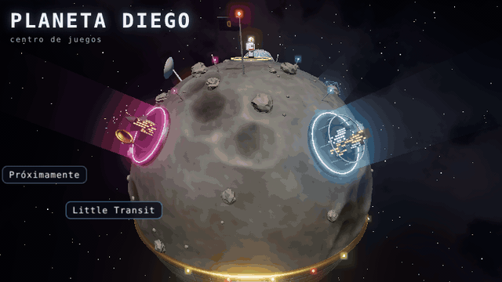
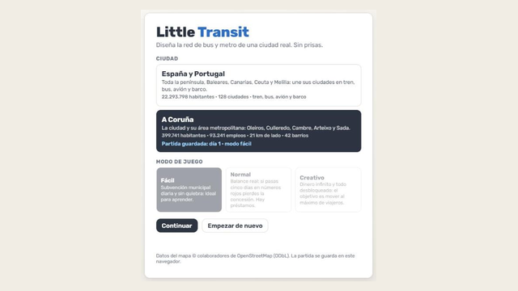
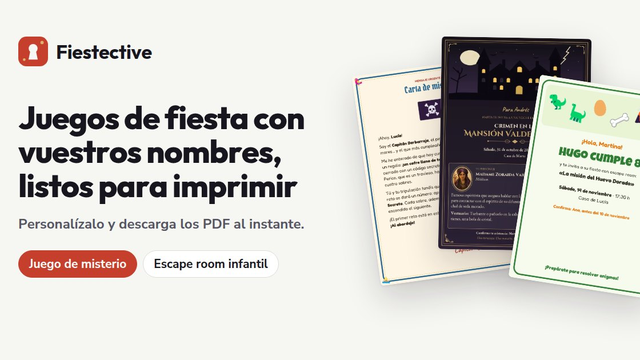
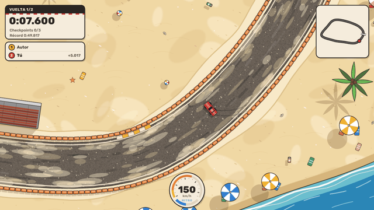
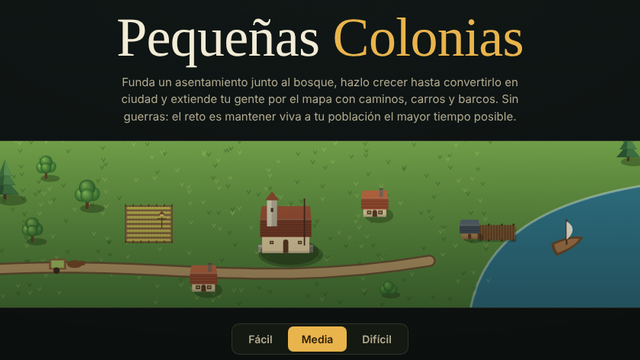

# Planeta Diego

**Mi centro de juegos.** Un pequeño planeta en 3D con gravedad lunar: aterriza, da unos saltos y entra en cada juego.

### [▶ Visitar Planeta Diego](https://diegomaartinez.github.io/)

## Juegos

<table>
  <tr>
    <td width="50%" align="center" valign="top">
      
      <h3><a href="https://diegomaartinez.github.io/city-game/">Little Transit</a></h3>
      Diseña el transporte de ciudades de verdad, sin prisas.
    </td>
    <td width="50%" align="center" valign="top">
      
      <h3><a href="https://fiestective.com/">Fiestective</a></h3>
      Juegos de misterio para fiestas, con vuestros nombres.
    </td>
  </tr>
  <tr>
    <td width="50%" align="center" valign="top">
      
      <h3><a href="https://littledrives.com/">Little Drives</a></h3>
      Contrarreloj de coches: derrapa y bate a tu fantasma.
    </td>
    <td width="50%" align="center" valign="top">
      
      <h3><a href="https://diegomaartinez.github.io/villages-game/">Pequeñas Colonias</a></h3>
      Funda núcleos, únelos con caminos y barcos, y mantén viva a tu gente.
    </td>
  </tr>
</table>
